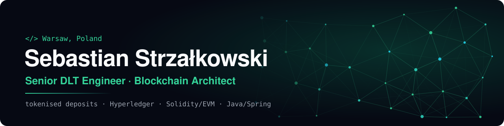

  

  
  
  
  
  

Senior DLT Engineer at **GFT** in Warsaw. I build enterprise blockchain systems for banks, from the smart contracts to the Java services that connect them to core banking. Software engineer since 2018, on-chain since 2021.

## What I work on

- **Tokenised deposits and RWA.** Delivered to production a tokenised deposits platform for a global Tier-1 bank: 24/7 interbank settlement, treasury liquidity and tokenised money-market-fund workflows.
- **Enterprise DLT.** Hyperledger Besu and Fabric, Kaleido BaaS, wholesale CBDC settlement rails, Fireblocks custody.
- **Smart contracts.** Solidity on Ethereum and L2s (Base, Polygon), Casper in Rust, contract security and gas optimisation.
- **Distributed systems.** Java 21 and Spring Boot, Apache Flink and Project Reactor streaming, PostgreSQL, AWS with Terraform.

## Now

- **Building [MaluchTracker](https://maluchtracker.pl)**, a privacy-first baby tracker on Google Play: React Native, Expo, TypeScript, Clean Architecture, no account and no ads.
- **AI-assisted engineering**: MCP, LLM gateways and spec-driven development in day-to-day work.

## Experience

| Role | Where | When |
| --- | --- | --- |
| Senior DLT Engineer | GFT | 2026 – now |
| DLT Engineer | ASTEK | 2025 – 2026 |
| Software Developer (telco data, IoT, cloud streaming, CRM) | Inetum | 2018 – 2025 |
| CTO (side project) | [Liqfinity](https://liqfinity.com), DeFi liquidity protocol | 2024 – 2025 |
| Blockchain lead developer (side project) | [Mystra](https://mystra.io), NFTs on Casper | 2022 |

Full history, projects and certificates: **[sebastian.i-can-do.it](https://sebastian.i-can-do.it)** ([po polsku](https://sebastian.i-can-do.it/pl/)).

## Talks

- **Wednesday Market Debates #4**, Cashify × Warsaw Enterprise Institute, 2026. Panel: *Ethereum in 2026: hit or flop?*
- **JVMDays Poznań**, 2025. Workshop: *Ethereum smart contracts from Java with Web3j*
- **Fiesta BFC**, Warsaw, 2023. *Who will dethrone Ethereum?*
- **Blockchain Alliance Opener**, Warsaw, 2022. *Web2 vs Web3: technology and business*
- **Web3 Devs Poland**, Kraków, 2022. *Web3 application architecture*

## Stack

  
  
  
  
  
  
  
  
  
  
  
  
  
  
  
  

Most of my work is for banks and clients, so it lives in private repositories. Happy to talk about it: **sebastian.strzalkowski@i-can-do.it**.
